<div align="center">


# Wherewise

### A heat map is not evidence.

Drop in a spreadsheet of events with locations. Wherewise draws it the way a cartographer would, tests which patterns are real, and hands you a print map, story brief or live dashboard you can defend.

[](https://wherewise.iamabuhuraira7.workers.dev)
[](https://github.com/abuhuraira99/wherewise/actions)
[](LICENSE)


[-0079c1?style=flat-square)](docs/certificate.png)

**[Open the live app](https://wherewise.iamabuhuraira7.workers.dev)** · [Field guide](https://wherewise.iamabuhuraira7.workers.dev/guide) · [How the statistics work](docs/METHODS.md) · [Architecture](docs/ARCHITECTURE.md)

</div>

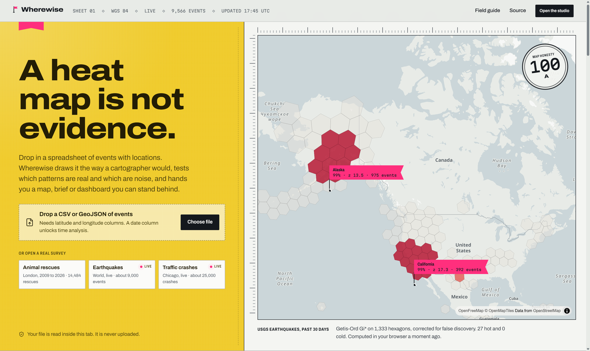

## Contents

- [Why it exists](#why-it-exists)
- [What it does](#what-it-does)
- [Screenshots](#screenshots)
- [The seven stations](#the-seven-stations)
- [The Map Honesty audit](#the-map-honesty-audit)
- [Architecture](#architecture)
- [Tech stack](#tech-stack)
- [Getting started](#getting-started)
- [Testing](#testing)
- [Deploying](#deploying)
- [Project structure](#project-structure)
- [Data sources and licences](#data-sources-and-licences)
- [Where this came from](#where-this-came-from)

## Why it exists

City service teams, NGO field staff, delivery operations, clinics and local newsrooms all keep spreadsheets of events with a location attached: complaints, crashes, outages, visits, incidents. Very few of them have a GIS analyst or an ArcGIS licence. So the data either never gets mapped, or it ends up as a bright heat map that mostly shows where people live.

Wherewise is the analyst they do not have. It reads the file, picks symbology that fits each column, runs the statistics that separate a real cluster from a visual one, finds where things are rising or falling, and builds the product the audience needs. Every map it produces is graded by a Map Honesty audit that flags choices which would mislead a reader, with a one-click fix for each.

Everything runs in the browser. Uploaded files never leave the tab.

## What it does

| Area | What you get |
| --- | --- |
| Reading the data | CSV, TSV and GeoJSON up to 250,000 rows. Detects latitude, longitude, dates (ISO, day-first and month-first), amounts, categories, free text and identifiers, and explains each decision. Rows at 0°,0° ("Null Island"), empty or out of range are counted and reported, never dropped silently. |
| Symbology | Single symbol, unique values (hue), graduated colour (lightness), proportional symbols (area-true) and a multivariate mode where size, colour and transparency each carry a different attribute. Natural breaks (Fisher-Jenks), quantile and equal interval, with goodness of variance fit. Colour-blind safe palettes checked by simulation. |
| Blending and labels | Real layer blending (the symbol layer is composited over the basemap with `multiply`, `overlay`, `screen` or `darken`) and feature blending between overlapping symbols. Label classes with a serif and a sans typeface, italics, halos, density limits and collision avoidance. |
| Calculated fields | A small, safe expression language modelled on Arcade: `$feature.Field`, `var`, `return`, `IIf`, `When`, `Round`, `Text`, `Weekday` and 20 more functions. No `eval`, a step budget, and helpful error messages ("Unknown function Rnd(). Try Round()"). |
| Pattern testing | Points, kernel heat map, equal-area H3 hexagons and Getis-Ord Gi* hot spots side by side. Gi* is corrected for multiple testing with the Benjamini-Hochberg false discovery rate. |
| Change over time | Per-hexagon Mann-Kendall trend tests with Sen's slope, emerging hot spot classes (new, consecutive, intensifying, persistent, diminishing, sporadic, oscillating, historical), small multiples with locked class breaks, and animation. Incomplete final periods are left out of every test. |
| 3D | Hexagons extruded by count, a space-time cube where each layer is one period, and camera bookmarks with a guided tour. |
| Linked charts | Category bars, histogram with the class breaks drawn on it, a data clock (hour by weekday) and a calendar heat chart. Clicking any part of a chart filters the map and every analysis. |
| Field notes | Click a hexagon to stake a note with its count, z-score, p-value, trend, slope, dominant categories and a sparkline. |
| Delivery | Choose the audience and purpose and the studio recommends a product, then builds it: a 2400 × 1697 print map with legend, north arrow, measured scale bar and sources; a printable story brief written from the results; a dashboard that refreshes live feeds every ten minutes; or an explorer link. |

## Screenshots

| | |
| --- | --- |
| 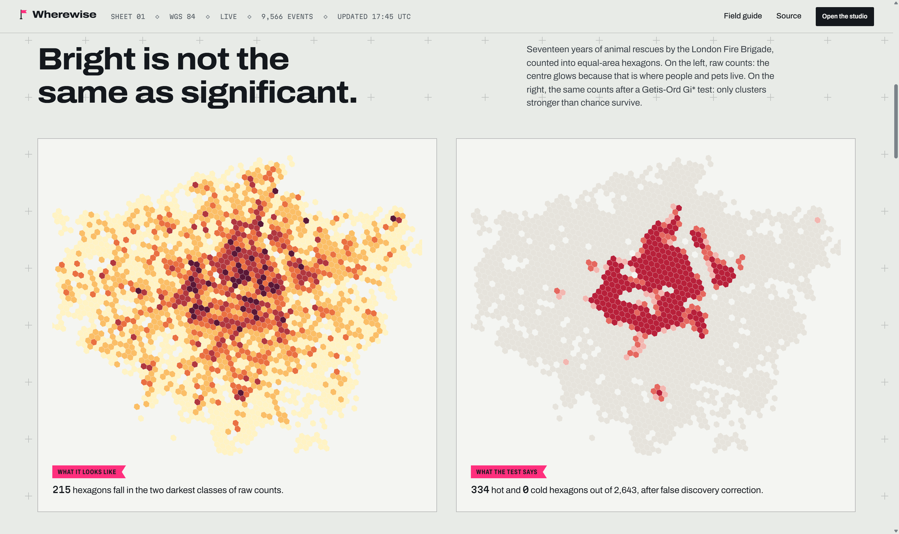 | 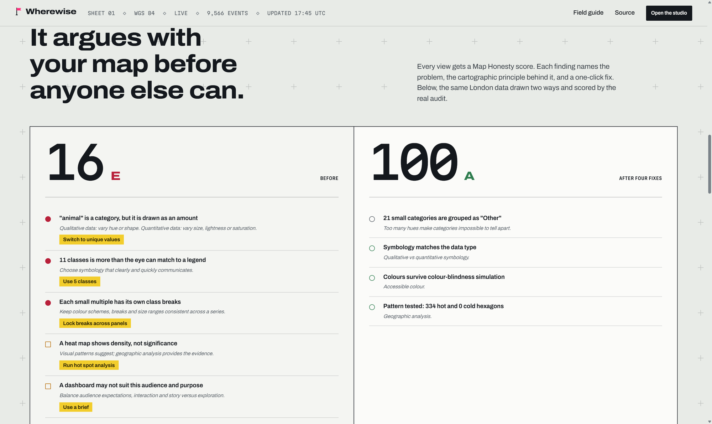 |
| The landing page compares raw counts with the Gi* result on 17 years of London Fire Brigade animal rescues. | The same data drawn two ways and scored by the real audit. |
| 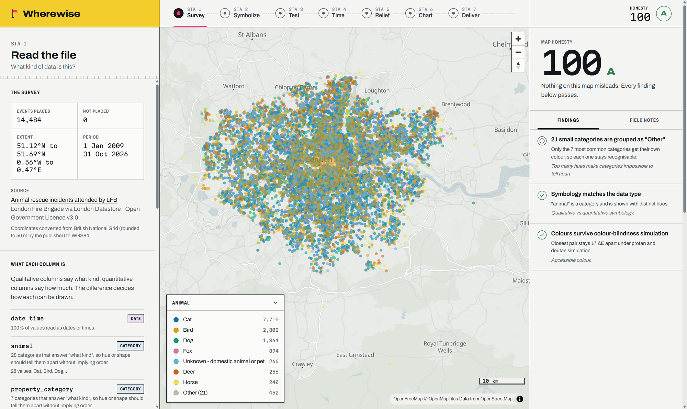 | 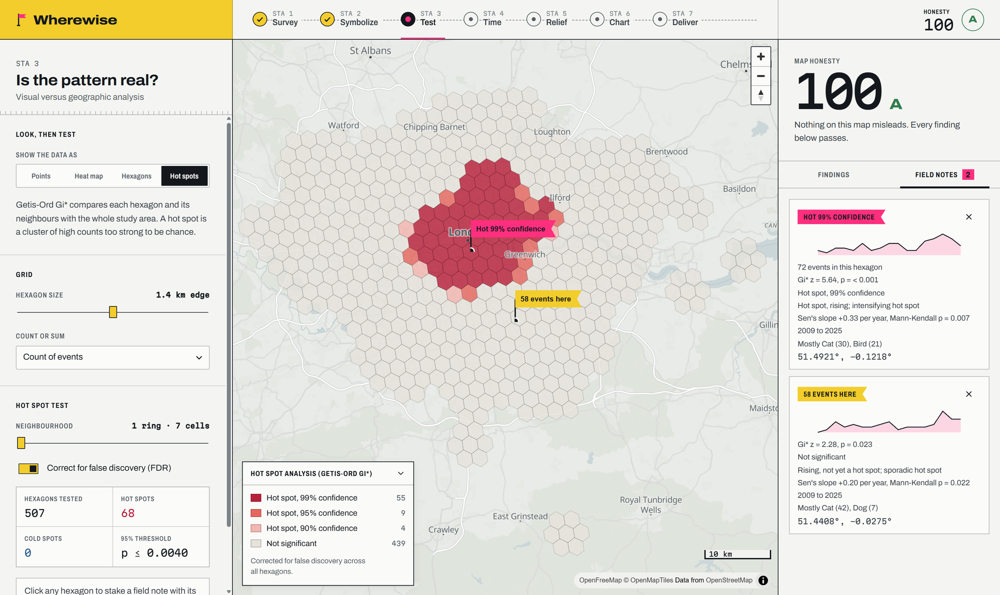 |
| Station 1 reads the file and explains every column. | Station 3 runs Gi* and stakes field notes on clicked hexagons. |
| 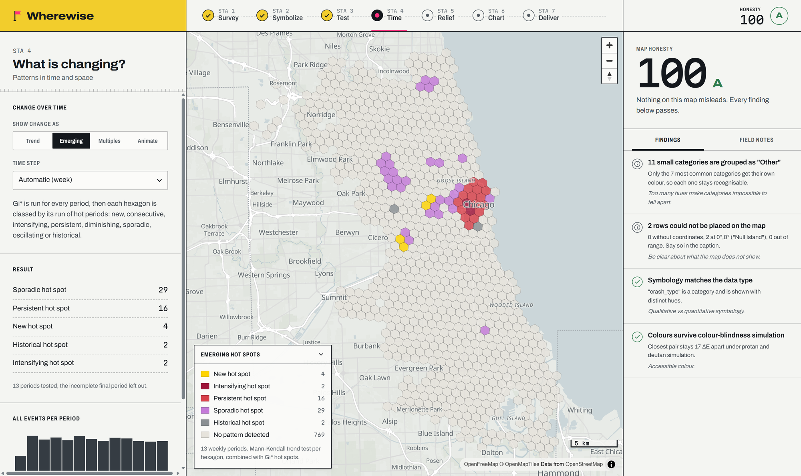 | 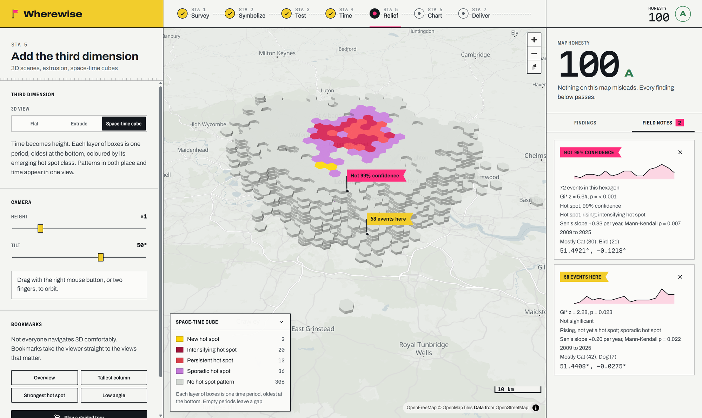 |
| Station 4 classes every hexagon by its run of hot periods. | Station 5 stacks time as height in a space-time cube. |
| 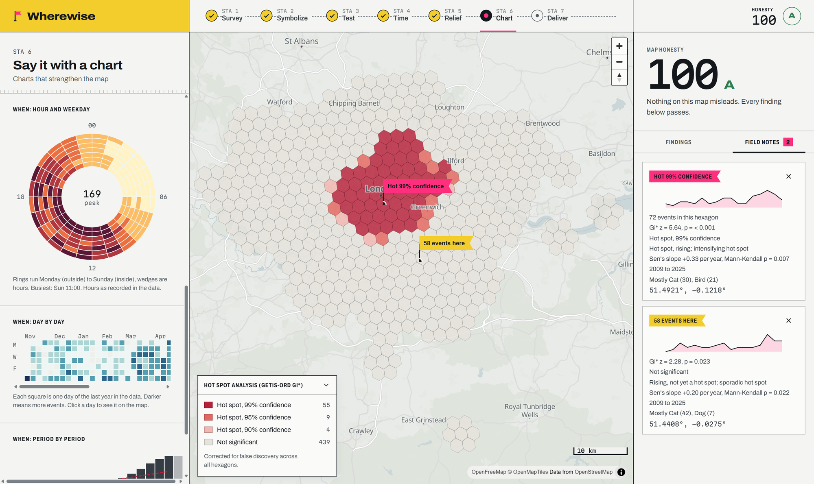 | 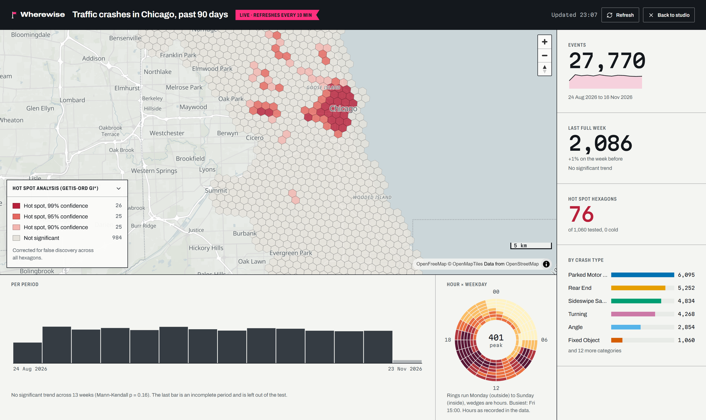 |
| Station 6 links charts to the map. | Station 7 builds a live dashboard. |
| 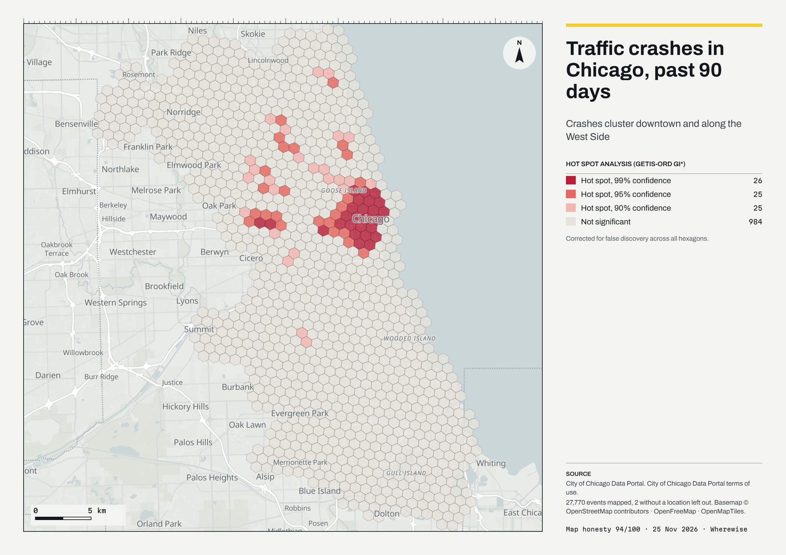 | 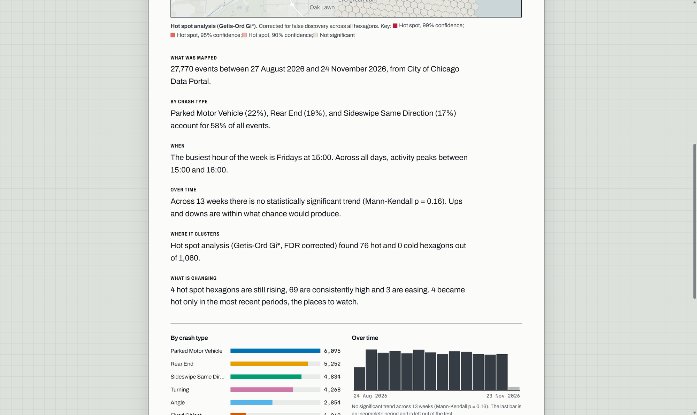 |
| A print map, exported as PNG. | A story brief, printable to PDF. |

<p align="center">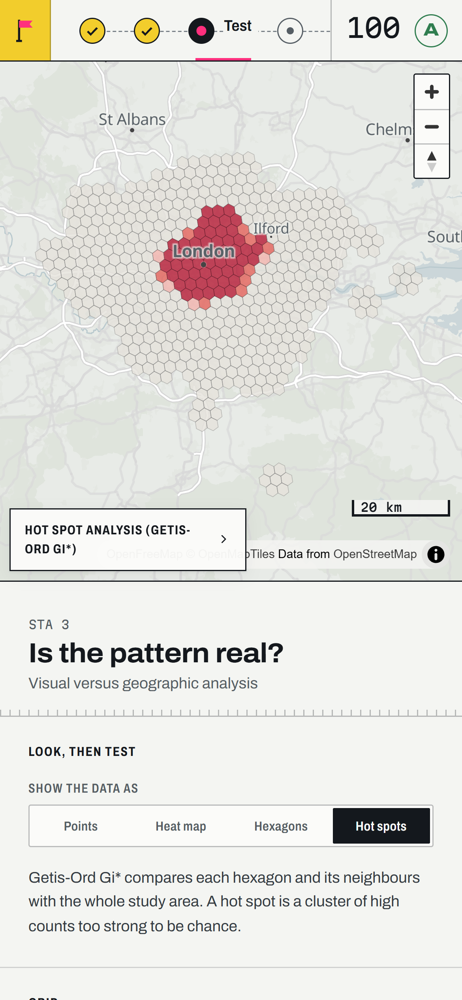</p>

## The seven stations

Surveyors walk a traverse from one fixed station to the next. The studio is laid out the same way, and every station puts one part of cartographic practice to work.

| Station | Question it answers | Course practice it applies |
| --- | --- | --- |
| STA 1 Survey | What kind of data is this? | Qualitative versus quantitative attributes |
| STA 2 Symbolize | How should it be drawn? | Symbology, labels and type conventions, transparency, layer and feature blending, Arcade expressions |
| STA 3 Test | Is the pattern real? | Visual versus geographic analysis, hot spot analysis |
| STA 4 Time | What is changing? | Small multiples, animation, space-time cubes, emerging hot spots |
| STA 5 Relief | Does 3D add anything? | Extrusion, viewpoints, bookmarks, 3D analysis of non-physical values |
| STA 6 Chart | What does the map not show? | Histograms, data clocks, calendar heat charts, charts in pop-ups, linked selection |
| STA 7 Deliver | Who is it for? | Choosing a print map, story, dashboard or app for an audience and purpose |

## The Map Honesty audit

The audit runs on every change and returns a score out of 100, a grade and a list of findings. Each finding names the problem, the principle behind it and, where it can, a fix.

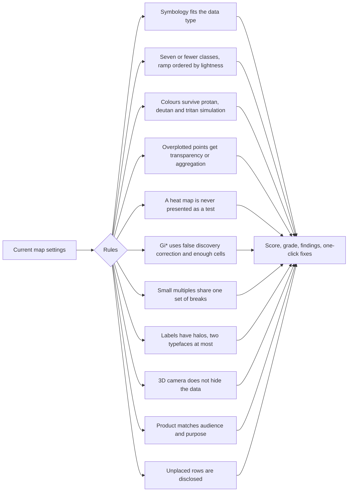

The colour check simulates colour vision deficiency with the Machado, Oliveira and Fernandes (2009) matrices and measures the closest pair of colours in CIE Lab. During development it caught a mistake in the default palette: a darkened yellow that was 1.1 ΔE away from orange under protanopia. The palette now uses the original Okabe-Ito yellow.

## Architecture

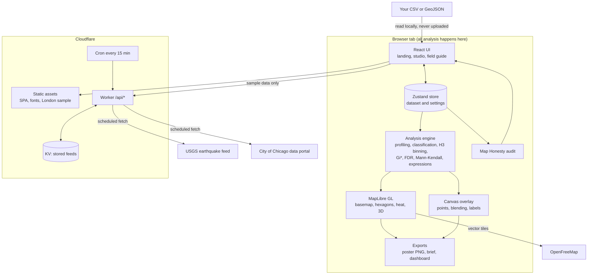

A few decisions worth explaining:

- The Worker never parses data. It fetches the public feeds on a 15 minute cron, stores the raw bytes in KV and serves them back, so each request costs a few milliseconds of CPU. Chicago's API can take 30 seconds to answer; visitors never wait on it, and if a source goes down they get the last good copy with a `x-wherewise-stale` header.
- Points and labels are drawn on a canvas synchronised with the MapLibre camera. That is what makes real blend modes and proper map typography possible. Hexagons, the heat map and 3D use MapLibre layers on the GPU.
- Heavy results (grids, Gi*, trends, colour schemes) are memoised per dataset and configuration, so switching stations is instant even with 30,000 points.

More detail in [docs/ARCHITECTURE.md](docs/ARCHITECTURE.md). The statistics are written up in [docs/METHODS.md](docs/METHODS.md).

## Tech stack

| Layer | Choice | Why |
| --- | --- | --- |
| UI | React 19, TypeScript (strict), Vite 8 | Fast builds, typed end to end |
| Maps | MapLibre GL JS 6, OpenFreeMap Positron (retinted) | Open source WebGL maps with no API key |
| Spatial index | h3-js | Equal-area hexagons and neighbourhood rings |
| Charts | d3-shape, d3-array, hand-written SVG | Full control over every mark |
| State | Zustand | Small, no boilerplate |
| Parsing | Papa Parse | Robust CSV with quoted fields |
| Edge | Cloudflare Workers, Workers KV, Cron Triggers, static assets | Global, always on, free tier friendly |
| Type | Archivo (variable width) and Martian Mono, self-hosted | Width axis for labels and display; mono for coordinates and counts |
| Tests | Vitest (26 unit tests), Playwright (Chrome, Edge, Firefox, WebKit, Android, iPhone, iPad) | Statistics verified against known answers; UI checked across browsers |

## Getting started

You need Node.js 20 or newer.

```bash
git clone https://github.com/abuhuraira99/wherewise.git
cd wherewise
npm install
npm run build          # type-check and build the app into dist/
npx wrangler dev       # serves dist/ and the /api worker on http://127.0.0.1:8787
```

For UI work with hot reload, run `npx wrangler dev` in one terminal and `npm run dev` in another. Vite proxies `/api` to the worker.

Try it with any CSV that has latitude and longitude columns, or with the three built-in samples.

## Testing

```bash
npm test                                   # unit tests: statistics, palettes, profiling, expressions
npx playwright install                     # once, to fetch browser engines
npm run test:e2e                           # end-to-end against the live site
BASE_URL=http://127.0.0.1:8787 npm run test:e2e   # against a local wrangler dev
```

The unit tests check the maths against known answers. Some examples: Jenks finds the obvious breaks in `[1,2,3,50,51,52,99,100,101]`; Gi* flags a planted cluster at 99% and leaves a flat field alone; FDR never finds more clusters than raw p-values; Mann-Kendall detects a rising series and stays quiet on noise and on ties; a cluster that grows every period is classed as an intensifying hot spot; every sequential ramp gets darker step by step.

The end-to-end suite uploads files (including one with no coordinates, one with day-first dates and broken rows, and a GeoJSON file), walks every station on the London sample, applies audit fixes, exports the poster and brief, opens the dashboard, checks the live feeds and the API error codes, and asserts there is no horizontal overflow and no console error.

## Deploying

```bash
npx wrangler login
npx wrangler kv namespace create FEEDS    # put the id in wrangler.jsonc
npm run deploy
```

The cron trigger fills KV within 15 minutes of the first deploy. Until then the first request to each feed fetches it directly.

## Project structure

```text
wherewise/
├── worker/index.ts              Edge worker: /api/health, /api/feeds/*, cron refresh into KV
├── public/
│   ├── data/lfb_animal_rescues.csv   London sample, converted from British National Grid to WGS84
│   └── _headers                 Security headers and cache rules
├── src/
│   ├── main.tsx                 Entry, router, fonts
│   ├── router.ts                Tiny history router
│   ├── state/store.ts           Zustand store: dataset, settings, selection, field notes
│   ├── lib/
│   │   ├── types.ts             Data model shared by every station
│   │   ├── compute.ts           Memoised grids, Gi*, trends, colour schemes
│   │   ├── palettes.ts          Ramps, Okabe-Ito, colour-vision simulation, contrast, ΔE
│   │   ├── data/                CSV and GeoJSON loading, profiling, samples
│   │   ├── stats/               classify.ts, hex.ts, gistar.ts, trend.ts
│   │   ├── expr/expression.ts   Expression language: tokenizer, Pratt parser, evaluator
│   │   └── honesty/audit.ts     Map Honesty rules and scoring
│   ├── map/
│   │   ├── basemap.ts           OpenFreeMap style, retinted, with an offline fallback
│   │   ├── pointsOverlay.ts     Canvas layer: symbols, blending, labels, hit testing
│   │   ├── layers.ts            Hexagon, Gi*, trend, cube and extrusion layers with legends
│   │   └── setup.ts             Registers the MapLibre worker for bundlers
│   ├── studio/                  Studio shell, map view, rail, the seven panels, deliverables
│   ├── charts/                  Bars, histogram, data clock, calendar heat chart, timeline
│   ├── landing/                 Landing page, live plate, field guide
│   ├── ui/                      Controls, drop well, wordmark, error boundary
│   └── styles/                  Tokens, base, landing, studio, print
├── tests/
│   ├── unit/                    Vitest
│   ├── e2e/                     Playwright
│   └── fixtures/                Synthetic test files
├── docs/                        Architecture, methods, design system, screenshots, certificate
├── PRODUCT.md                   Product record
└── DESIGN.md                    Visual system
```

## Data sources and licences

| Dataset | Publisher | Licence |
| --- | --- | --- |
| Animal rescue incidents attended by LFB, 2009 to 2026 | London Fire Brigade via London Datastore | Open Government Licence v3.0 |
| Earthquakes, past 30 days | U.S. Geological Survey | Public domain |
| Traffic Crashes, past 90 days | City of Chicago Data Portal | City of Chicago terms of use |
| Basemap | OpenStreetMap contributors, OpenFreeMap, OpenMapTiles | ODbL and CC-BY |

The London rescues publish coordinates on the British National Grid, rounded to 50 m. They were converted to WGS84 with an Airy 1830 inverse transverse Mercator followed by a Helmert transformation. Compared with the subset that also has published latitude and longitude, the result is within 53 m, which is the rounding.

The code is released under the [MIT licence](LICENSE).

## Where this came from

I built Wherewise as the final project after completing Esri's six-week MOOC *The Power of Where: Communicating with Maps* (October to December 2026), taught by Flora Vale with John Nelson, Tommy Fauvell, Warren Davison and Ankita Bakshi. The course covers symbology, labels, blending and Arcade, 3D scenes, visual versus geographic analysis, charts, change over time and choosing a product for an audience. Wherewise puts each of those into a tool anyone can use without a GIS licence.

<p align="center"></p>

Wherewise is an independent project. It is not affiliated with or endorsed by Esri. Esri and ArcGIS are trademarks of Esri.

<p align="center">Built by <a href="https://www.linkedin.com/in/abu-huraira-dev/">Abu Huraira</a></p>
