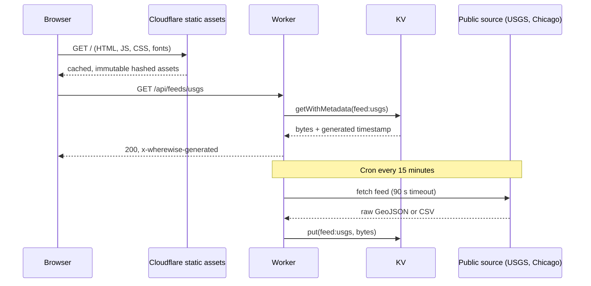
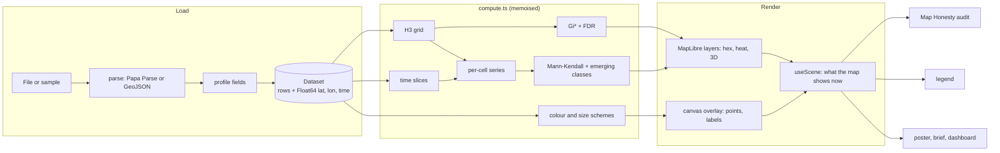

# Architecture

## Principles

1. The user's data never leaves the browser. There is no account, no upload endpoint and no database of user content.
2. The edge does as little as possible. The Worker moves bytes; it does not parse them.
3. Every expensive result is computed once per dataset and configuration.
4. Nothing a visitor sees depends on a third-party API answering in time.

## Request flow

If KV is empty (first deploy) the Worker fetches the source directly. If the stored copy is older than two refresh intervals it is still served while a refresh runs in the background. After eight missed intervals the response carries `x-wherewise-stale: 1` and the studio says so.

## Inside the browser

`useScene` is the single place that decides what the map shows for the current station and settings. The map component, the legend, the audit and the exports all read from it, so they can never disagree.

## The canvas overlay

MapLibre's circle layer cannot blend with the basemap or with itself, and its symbol layer only has the glyph fonts the tile server ships. The overlay solves both:

- Positions are converted to Web Mercator once. Each frame applies the camera transform directly (about 2 ms for 30,000 points).
- Points are grouped by colour and alpha so each group is a single path fill.
- Layer blending is the CSS `mix-blend-mode` of the canvas over the WebGL map. Feature blending is the canvas `globalCompositeOperation`.
- Screen positions from the last frame are kept for hit testing and for labels.
- Labels are evaluated with the expression language, placed greedily with padded collision boxes, and capped at roughly one per 120 × 120 px.

## Security

- `public/_headers` sets a strict Content-Security-Policy (only self, OpenFreeMap tiles, blob workers for MapLibre), `X-Content-Type-Options`, `Referrer-Policy`, `Permissions-Policy` and `X-Frame-Options`.
- The expression language has no access to globals, no loops and a step budget of 5,000 operations per evaluation.
- Popups escape every value taken from the data.
- The API accepts only GET and HEAD and answers unknown routes with 404.

## Performance

- MapLibre and h3-js are split into their own chunks; the studio and field guide are lazy-loaded.
- Hashed assets are cached for a year; the London sample for a day.
- The London sample (14,484 rows) profiles and renders in under a second on a mid-range laptop; Chicago (about 28,000 rows) in about two.
